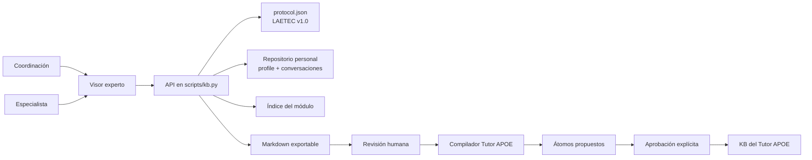
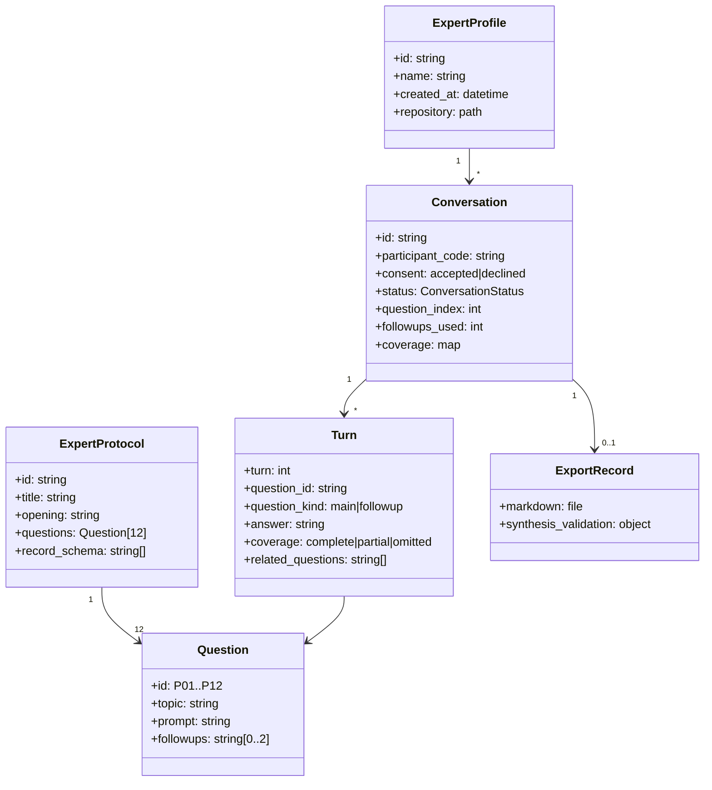
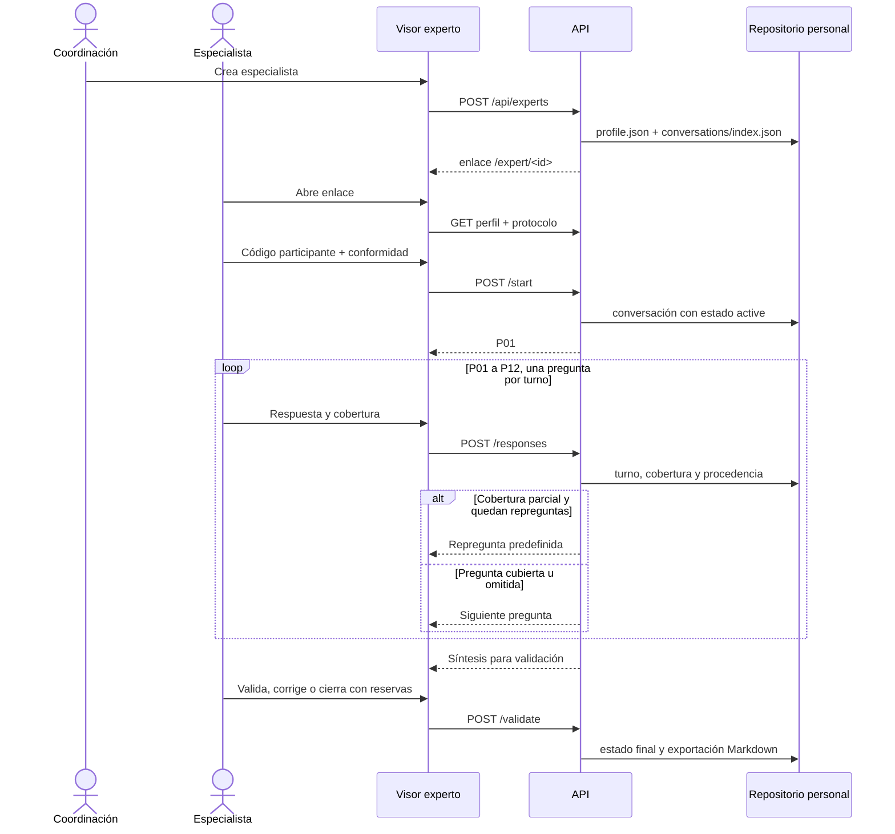
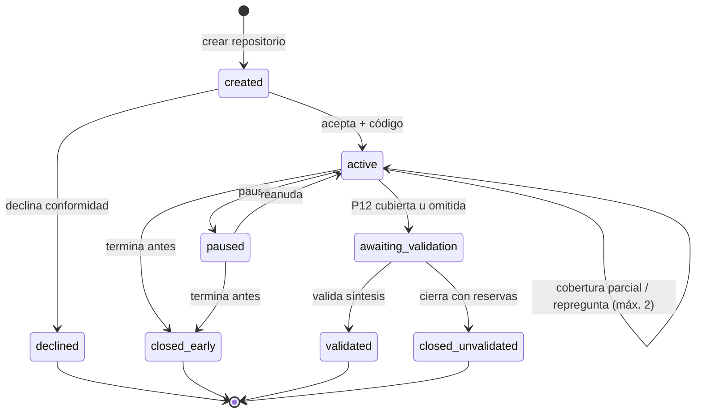
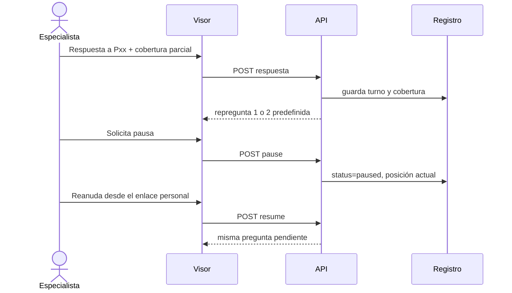
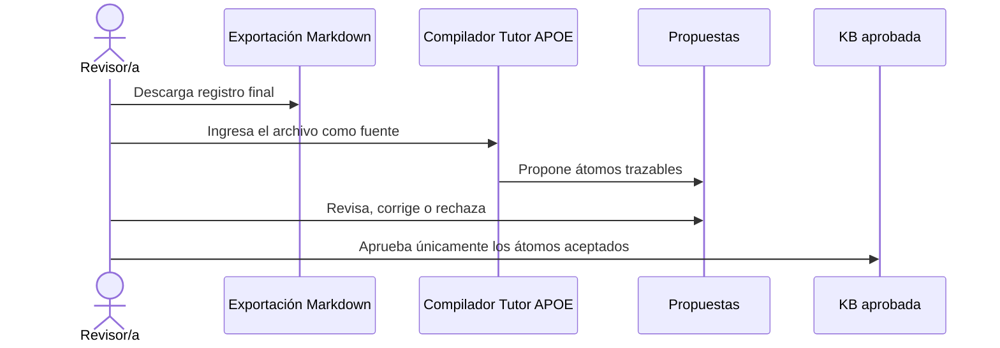

# Módulo experto APOE

## Propósito

El módulo experto APOE recoge entrevistas semiestructuradas a investigadores que
conocen la teoría APOE. Su finalidad es producir evidencia atribuible y
revisable para el módulo experto; **no incorpora conocimiento directamente a
los átomos del Tutor APOE**.

El protocolo implementado es LAETEC v1.0. Conserva P01–P12, sus repreguntas y
los requisitos de conformidad, código de participante, pausa, reanudación y
validación de síntesis definidos en `knowledge/expert-apoe/protocol.json`.

## Alcance y límites

- La persona coordinadora crea una invitación por especialista.
- Cada invitación tiene un repositorio local separado para perfil,
  conversaciones, transcripciones y exportaciones.
- El entrevistador presenta solamente preguntas y repreguntas predefinidas del
  protocolo; no inventa interpretaciones ni modifica respuestas.
- Una entrevista terminada genera un Markdown exportable. Es una **fuente de
  entrevista**, no un átomo ni una propuesta aprobada.
- La incorporación al Tutor APOE requiere el proceso normal: ingesta, propuesta,
  revisión humana y aprobación explícita.

## Componentes y responsabilidades

| Componente | Ubicación | Responsabilidad |
|---|---|---|
| Visor de coordinación e entrevista | `web/expert.html`, `web/expert.js`, `web/expert.css` | Muestra el protocolo, crea invitaciones y conduce cada sesión. |
| API y persistencia | `scripts/kb.py` | Sirve el visor, controla estados, guarda turnos y produce exportaciones. |
| Protocolo | `knowledge/expert-apoe/protocol.json` | Define apertura, P01–P12, repreguntas, esquema de registro y referencia de diseño. |
| Repositorio por especialista | `knowledge/expert-apoe/experts/<id>/` | Conserva evidencia de una persona experta sin mezclarla con otras. |
| Índice del módulo | `knowledge/expert-apoe/module.json` y `README.md` | Reúne conteos y rutas de repositorios personales. |
| Compilador del Tutor APOE | `tutor compile …` | Ingiere el Markdown como fuente y propone átomos para revisión; no se ejecuta automáticamente. |

## Diagrama de componentes



El diagrama separa deliberadamente la entrevista de la KB. La única ruta hacia
la KB pasa por revisión humana y aprobación.

## Modelo de información



Un turno puede declarar que anticipa otra pregunta, por ejemplo `P07`. Al
llegar a ella, el visor conserva el turno original y pide completar o matizar
solamente lo que falte.

## Casos de uso

| Actor | Caso de uso | Resultado |
|---|---|---|
| Coordinación | Configurar o verificar protocolo | Usa las preguntas y condiciones vigentes. |
| Coordinación | Crear invitación | Se crea `expert-<nombre>-<id>` y un enlace personal. |
| Especialista | Aceptar o declinar | Se registra la conformidad antes de formular preguntas. |
| Especialista | Responder, omitir o pedir profundización | Se guarda un turno con cobertura y, si corresponde, una repregunta. |
| Especialista | Pausar y reanudar | Se conserva la posición exacta y la siguiente pregunta. |
| Especialista | Validar síntesis o cerrar con reservas | Se registra el estado final y se habilita la exportación. |
| Equipo de investigación | Revisar e ingerir exportación | Puede proponer conocimiento nuevo, nunca publicarlo sin aprobación. |

## Secuencia de una entrevista



## Estados de conversación



Los estados terminales generan un archivo de exportación. `declined` no formula
preguntas.

## Pausa, cobertura y repreguntas



No se generan más de dos repreguntas por pregunta troncal. Si se registra una
cobertura parcial sin una repregunta disponible, el visor avanza y conserva la
cobertura como parcial.

## Repositorio personal y trazabilidad

Cada especialista vive en una carpeta independiente:

```text
knowledge/expert-apoe/experts/expert-<nombre>-<id>/
├── profile.json
├── conversations/
│   ├── index.json
│   ├── conversation-<id>.json
│   └── conversation-<id>.md
└── exports/
    └── conversation-<id>.md
```

El JSON mantiene el estado operativo; la transcripción Markdown ofrece lectura
humana; el exportable añade metadatos de conformidad, estado, protocolo,
respuestas y validación. Por tanto, una interpretación puede remitirse al
código de participante, identificador de pregunta y turno.

## Del cierre a la KB del Tutor APOE



Con el CLI disponible, el flujo operativo es:

```bash
# Copiar el archivo descargado a una carpeta de fuentes del proyecto.
tutor compile ingest sources/entrevistas/<archivo>.md --kb kbs/apos --title "Entrevista experta APOE"

# Pedir propuestas, pero no escribirlas todavía.
tutor compile run "criterios operativos extraídos de entrevista experta APOE" --kb kbs/apos --max 5 --dry-run
```

Después se revisan las propuestas y se aprueban individualmente con el flujo
descrito en `docs/compiler.md`. Las transcripciones pueden contener opiniones,
ambigüedades o desacuerdos; estos se conservan como evidencia atribuida y no
se convierten por sí mismos en afirmaciones de la KB.

## Interfaz y rutas

| Ruta | Uso |
|---|---|
| `/expert` | Coordinación: protocolo, invitaciones e índice de especialistas. |
| `/expert/<id>` | Sesión de la persona especialista. |
| `POST /api/experts` | Crea perfil y enlace. |
| `POST /api/experts/<id>/start` | Registra conformidad y código. |
| `POST /api/experts/<id>/responses` | Registra un turno y su cobertura. |
| `POST /api/experts/<id>/pause` y `/resume` | Controla continuidad de sesión. |
| `POST /api/experts/<id>/validate` | Cierra y genera la exportación. |
| `GET /api/experts/<id>/export?conversation=<id>` | Descarga el Markdown exportable. |

## Restricciones de despliegue y privacidad

La instalación actual se sirve en `127.0.0.1`; sus enlaces funcionan solo en
esta máquina. Antes de invitar a personas externas se necesita un despliegue
con URL compartida, autenticación, política de tratamiento de datos y copias
de seguridad acordes con el equipo de investigación. La interfaz actual no
incluye autenticación ni una política de anonimización automática.

## Verificación realizada

Se verificaron en una entrevista simulada y aislada:

- aceptación y declinación de conformidad;
- presentación de P01 y registro de código;
- cobertura parcial y repregunta predefinida;
- pausa y reanudación en la pregunta pendiente;
- referencia a un turno que anticipa una pregunta posterior;
- cierre temprano, validación y generación de Markdown exportable;
- sintaxis de Python, JavaScript y consistencia del diff.

No se usaron las respuestas de una entrevista real durante estas pruebas.
