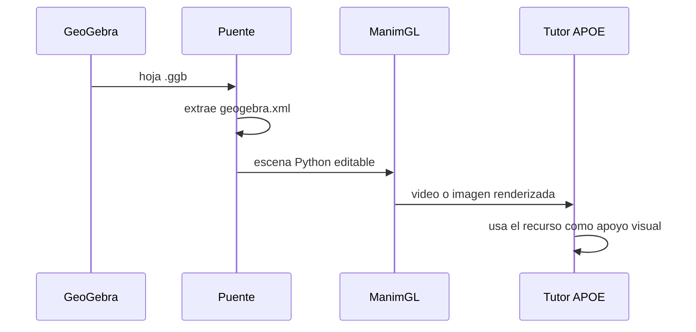

# Puente GeoGebra → ManimGL

Este puente transforma una construcción 2D guardada en GeoGebra en una escena
Python editable para **ManimGL**, la variante de Manim del repositorio
[3b1b/manim](https://github.com/3b1b/manim).

## Qué integra

1. GeoGebra guarda una hoja `.ggb`.
2. `scripts/geogebra_manim.py` abre su `geogebra.xml` y extrae puntos libres y
   las órdenes `Segment`, `Line` y `Circle` cuando sus dependencias son puntos.
3. Genera una clase `Scene` que usa ejes, puntos, etiquetas y animaciones
   `Create`/`FadeIn` de ManimGL.
4. La escena queda disponible para usarla en explicaciones visuales del Tutor
   APOE, sin convertir automáticamente la construcción en conocimiento de la
   KB.



## Uso

```bash
python scripts/geogebra_manim.py construccion.ggb \
  --output visualizaciones/rotacion.py \
  --scene Rotacion90 \
  --title "Rotación de 90 grados"
```

Para renderizar, instala ManimGL en un entorno aislado y ejecuta:

```bash
python -m pip install manimgl
manimgl visualizaciones/rotacion.py Rotacion90 -w
```

ManimGL requiere Python 3.10 o superior; su documentación declara FFmpeg y
OpenGL como requisitos de sistema, y LaTeX como opcional para fórmulas. Los
archivos `.ggb` son contenedores ZIP cuyo contenido principal es
`geogebra.xml`, según la documentación de GeoGebra. [ManimGL](https://github.com/3b1b/manim), [formato GeoGebra](https://geogebra.github.io/docs/reference/en/File_Format/).

## Límites actuales

- Solo soporta puntos libres, segmentos, rectas y círculos definidos por puntos.
- No evalúa CAS, deslizadores, animaciones propias de GeoGebra, cónicas,
  funciones ni construcciones 3D.
- Una orden no representable se informa como advertencia y se omite; nunca se
  inventa su geometría.
- La salida es un guion de animación que el equipo puede revisar y editar antes
  de renderizar.
